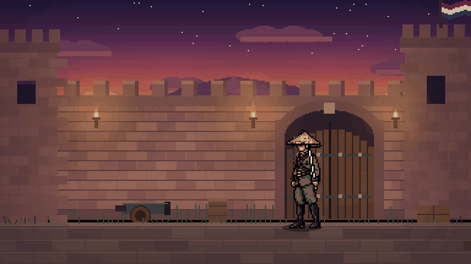

# Attack on Diponegoro

> Rusdi vs. pasukan kolonial. 2D action platformer..

  
   
  <em>Concept preview. Bukan rekaman gameplay asli.</em>

## Tentang Game
Jawa, 1825. Perang besar pecah ketika Pangeran Diponegoro mengangkat
perlawanan terhadap kekuasaan kolonial Belanda. Desa-desa terbakar,
pasukan Belanda menguasai jalur-jalur penting, dan rakyat hidup dalam
bayang-bayang ketakutan.

Di tengah kekacauan itu, **Rusdi**, seorang pejuang muda, mengangkat senjata.
Ia bukan pahlawan legendaris, hanya satu dari banyak orang yang menolak diam.
Dari hutan, sawah, hingga benteng musuh, Rusdi harus menembus barisan
pasukan Belanda dan membuka jalan bagi perlawanan.

**Attack on Diponegoro** adalah game 2D action platformer bergaya metroidvania
dengan combat yang berat dan menuntut ketepatan. Setiap musuh memberi
tanda sebelum menyerang, dan pemain yang sabar membaca gerakan lawan lalu
melakukan **parry** tepat waktu akan menjatuhkan postur musuh dan membalas
dengan serangan telak.

## Fitur
- Sistem parry dengan jendela waktu dan attack cancel
- Health dan posture damage
- Musuh dengan telegraph serangan yang bisa dibaca
- *(progres)*

## Status
🚧 Dalam pengembangan

- [x] Karakter utama dan animasi dasar
- [x] Sistem parry
- [x] Health dan posture damage
- [x] AI musuh pertama
- [x] Hit-stop dan feedback combat
- [ ] Ruangan uji dan checkpoint
- [ ] Beberapa area dan musuh baru
- [ ] Polish: animasi, VFX, SFX

## Kontrol
| Aksi | Tombol |
|------|--------|
| Gerak | A / D |
| Lompat | Space |
| Serang | Klik Kiri / J |
| Parry | Klik Kanan / K |
| Dodge | Shift |

## Dibuat dengan
- Unity 6 (6000.6.5f1)
- C#

## Cara menjalankan
1. Clone repo ini
2. Buka lewat Unity Hub dengan versi Unity yang sama
3. Buka scene utama di `Assets/Scenes`, lalu tekan Play